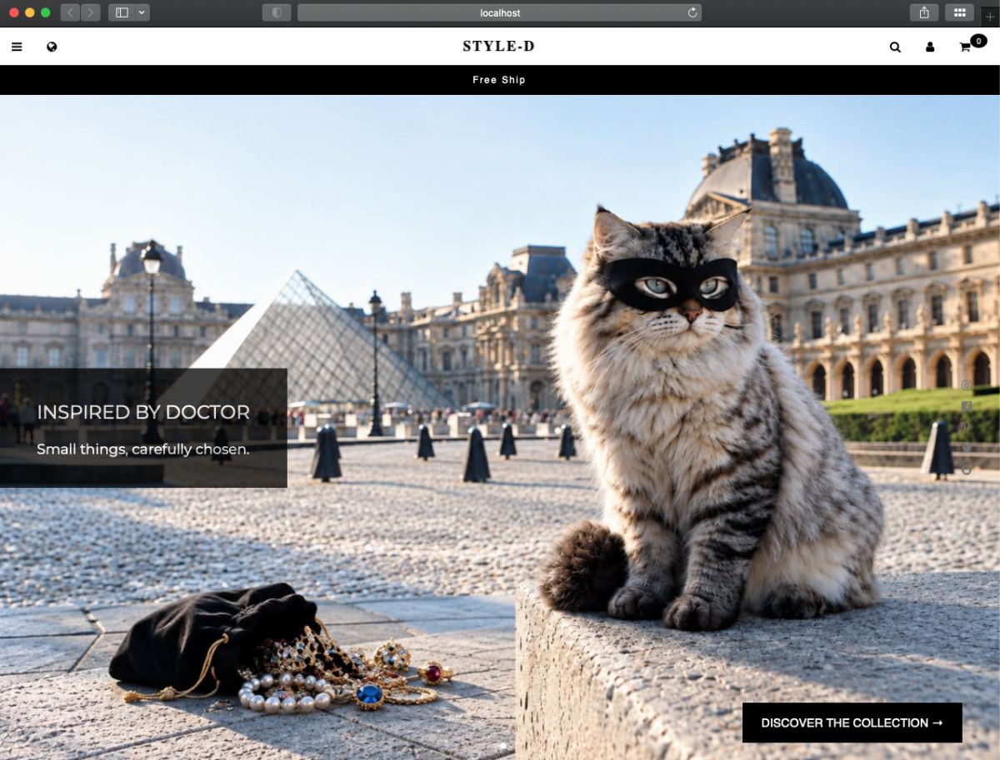

# Mini E-commerce (Serverless)

A modern, bilingual Full-Stack e-commerce application built with a Serverless architecture leveraging **React**, **Supabase**, and **Stripe**.

---

## Demo

### Website:

[](https://yinhsunchang.github.io/e-shop)

### Demo Accounts:

- **Customer Space:**

  - **Email:** `demo.user@eshop.com`
  - **Password:** `demo!user`

- **Admin Dashboard:**

  - **Email:** `demo.admin@eshop.com`
  - **Password:** `demo!admin`

---

## Payment Test

This project uses Stripe in test mode. You can test the checkout flow using the following test card.

- Card number: 4242 4242 4242 4242
- Expiration date: Any future date (e.g. 12/30)
- CVC: Any 3 digits (e.g. 123)

Notes

- No real payment will be processed when using Stripe test mode.
- Use test card details only. No real credit card information is required.

---

## Key Features

### Customer

- User registration and login
- Product browsing
- Product detail pages
- Shopping cart
- Checkout
- Stripe payments
- Order history
- Order status tracking

### Admin

- Product management
- Inventory management
- Order management
- Order status updates
- Row Level Security
- Stripe webhook handling
- Subscriber management
- Message management

---

## Tech Stack

- Frontend: Vite, React, TypeScript, React Router
- Backend: Supabase
- Payment: Stripe
- Styling: CSS
- UI & Animation: Framer Motion, Swiper
- Fonts & Icons: Google Fonts, Font Awesome
- Internationalization: react-i18next
- Head Management/SEO: React Helmet Async
- Testing: Vitest, React Testing Library
- Deployment: GitHub Actions (CI/CD), GitHub Pages (Frontend)

---

## System Architecture

```bash
┌────────────────────────────────────────────────────────┐
│                   FRONTEND (React)                     │
│      React • CSS • Framer Motion • Swiper • i18n       │
└──────────────────────────┬─────────────────────────────┘
                           │ (HTTPS / WebSockets)
                           ▼
┌────────────────────────────────────────────────────────┐
│                   BACKEND (Supabase)                   │
│      Auth: Session & Role management                   │
│      PostgreSQL: Relational Database                   │
│      RLS: Row Level Security (Table isolation)         │
│      Storage: Product assets and media                 │
└──────────────────────────┬─────────────────────────────┘
                           │ (Triggers / Event Listeners)
                           ▼
┌────────────────────────────────────────────────────────┐
│             SUPABASE EDGE FUNCTIONS & STRIPE           │
│      create-checkout-session ──► Secure Redirect       │
│      stripe-webhook ◄── Payment Status Confirmations   │
└────────────────────────────────────────────────────────┘
```

---

## Folder Structure

```bash
src
├── assets
├── auth
├── cart
├── components
├── i18n
├── layouts
├── lib
├── pages/
│   ├── 404/
│   ├── about/
│   ├── admin/
│   ├── contact/
│   ├── home/
│   ├── product/
│   ├── signup/
│   ├── signin/
│   ├── subscribe/
│   └── user/
├── routes
├── services
├── types
├── App.css
├── App.tsx
├── main.css
└── main.tsx
```

---

## Security & Data Integrity

- **Row Level Security (RLS):** Strict backend database-level policies prevent unauthorized mutations. End-users can exclusively query their own billing data and personal profile history.
- **Idempotent Inventory Management:** Product stock counts are decremented via server-side PostgreSQL RPC functions during Stripe Webhook execution, effectively mitigating race condition risks.
- **Secret Management:** Private Stripe API keys are safely injected into Supabase Edge Function environment variables, ensuring zero exposure to the client-side browser bundle.

---

## Getting Started

Follow the steps below to run the project locally.

```bash
# 1. Clone the repository
git clone https://github.com/yinhsunchang/e-shop.git
cd e-shop

# 2. Install dependencies
npm install

# 3. Run the development server
npm run dev
```

---

## Possible Improvements

- Support advanced product variants, such as multiple colors, sizes, and combinations of attributes.
- Expand admin functionalities
- Improve accessibility
- Optimize performance
- Implement end-to-end (E2E) testing

---

## License, Copyright & Credits

- Code License: MIT License © Yin-Hsun Chang. See the [LICENSE](LICENSE) file for details.
- Images & Media: © Yin-Hsun Chang. All images and media files are not covered by the MIT License and may not be used without permission.
- Third-Party Resources: This project uses third-party resources, which are subject to their respective licenses.
- Design Reference: Inspired by the W3Schools "Parallax" and "Dark Portfolio" templates.
